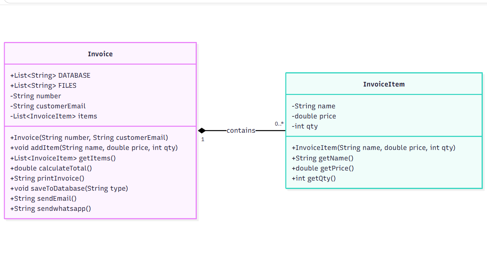
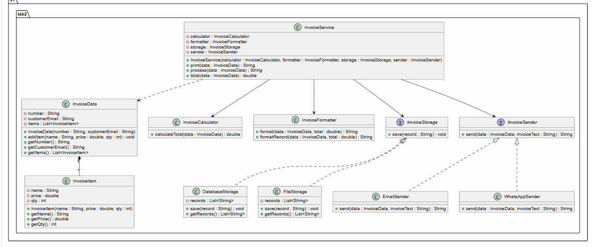

# Lab 01 - Invoice Refactoring

## الفريق: team03

| الاسم الثلاثي           | الرقم الجامعي | GitHub                      | الدور                                  |
|:------------------------|:--------------|:----------------------------|:---------------------------------------|
| بتول حسن اليونس         | [1722198938]  | [@batoul351]                | بناء النسخة القديمة وتحليل المسؤوليات  |
| إيمان محمد نور الشنبور  | [1722166936]  | [@eman2005sha]              | تصميم UML وإعادة هيكلة الأصناف         |
| لجين محمد غياث القاضي   | [1720068600]  | [@Lujainki]                 | حساب LCOM1 والتوثيق والتحقق            |
| عائشة عبد المعين الطويل | [1722197259]  | []                          | تنفيذ النسخة الجديدة ومقارنة المخرجات  |
| أروى حفيظ عماد          |  [1721123280] | [@Arwa-desin]               | مراجعة الكود وتجهيز التسليم            |
---

## التشغيل
* **النسخة القديمة:** `Run As -> Java Application` على `s1.lab1.Main`
* **النسخة الجديدة:** `Run As -> Java Application` على `s1.lab2.Main`

---

## تحليل النسخة القديمة (`s1.lab1.Invoice`)

### 1. جدول المسؤوليات وأسباب التغيير
| المسؤولية | الدوال المرتبطة | سبب التغيير (Reason to Change) |
| :--- | :--- | :--- |
| **إدارة بيانات الفاتورة والبنود** | `addItem`, `getItems` | تغير هيكل بيانات الفاتورة أو طريقة تمثيل وإضافة البنود. |
| **حساب المجموع والخصم والضريبة** | `calculateTotal` | تغير قواعد الحساب المالي (نسبة الخصم 5%، حد الـ 1000، أو نسبة الضريبة 15%). |
| **تنسيق وطباعة الفاتورة** | `printInvoice` | تغير شكل الفاتورة المطبوعة أو تنسيق النصوص والأرقام. |
| **الحفظ والتخزين** | `saveToDatabase` | تغير آلية الحفظ أو تنسيق السجل المخزن (`number;email;total`). |
| **الإرسال عبر البريد الإلكتروني** | `sendEmail` | تغير صيغة رسالة البريد الإلكتروني أو طريقة إرسالها. |
| **الإرسال عبر واتساب** | `sendwhatsapp` | تغير صيغة رسالة واتساب أو طريقة إرسالها. |

### 2. حساب LCOM1 للصنف القديم `Invoice`
* **حقول الكائن (بعد استثناء الحقول الثابتة `DATABASE` و `FILES`):** `number`, `customerEmail`, `items`.
* **الدوال المحسوبة (بعد استثناء الـ Constructor والدالة `getItems`):** 6 دوال (`addItem`, `calculateTotal`, `printInvoice`, `saveToDatabase`, `sendEmail`, `sendwhatsapp`).
* **الحقول المستخدمة مباشرة في كل دالة:**
    * `addItem`: `{items}`
    * `calculateTotal`: `{items}`
    * `printInvoice`: `{number, items}`
    * `saveToDatabase`: `{number, customerEmail}`
    * `sendEmail`: `{number, customerEmail}`
    * `sendwhatsapp`: `{number}`

#### جدول أزواج الدوال الكامل (15 زوجاً):
| # | الزوج (الدالة 1 ، الدالة 2) | الحقول المشتركة (مباشرة) | هل يشتركان في حقل؟ | يُحسب في LCOM1؟ |
| :-: | :--- | :-: | :-: | :-: |
| 1 | (`addItem`, `calculateTotal`) | `items` | نعم | لا |
| 2 | (`addItem`, `printInvoice`) | `items` | نعم | لا |
| 3 | (`addItem`, `saveToDatabase`) | - | **لا** | **نعم (1)** |
| 4 | (`addItem`, `sendEmail`) | - | **لا** | **نعم (2)** |
| 5 | (`addItem`, `sendwhatsapp`) | - | **لا** | **نعم (3)** |
| 6 | (`calculateTotal`, `printInvoice`) | `items` | نعم | لا |
| 7 | (`calculateTotal`, `saveToDatabase`) | - | **لا** | **نعم (4)** |
| 8 | (`calculateTotal`, `sendEmail`) | - | **لا** | **نعم (5)** |
| 9 | (`calculateTotal`, `sendwhatsapp`) | - | **لا** | **نعم (6)** |
| 10 | (`printInvoice`, `saveToDatabase`) | `number` | نعم | لا |
| 11 | (`printInvoice`, `sendEmail`) | `number` | نعم | لا |
| 12 | (`printInvoice`, `sendwhatsapp`) | `number` | نعم | لا |
| 13 | (`saveToDatabase`, `sendEmail`) | `number`, `customerEmail` | نعم | لا |
| 14 | (`saveToDatabase`, `sendwhatsapp`) | `number` | نعم | لا |
| 15 | (`sendEmail`, `sendwhatsapp`) | `number` | نعم | لا |

* **قيمة `LCOM1` للصنف القديم = 6** *(ملاحظة: باعتماد الوصول المباشر للحقول، أما في حال احتساب الاستدعاء غير المباشر للدوال الداخلية `calculateTotal` و `printInvoice` فإن جميع الدوال تشترك في الحقل `items` وتكون القيمة `0`)*.

---

## التصميم الجديد

* مخطط UML قبل: 
* مخطط UML بعد: 

### قياس `LCOM1` بعد إعادة الهيكلة ومقارنة قبل وبعد

| الصنف | مسؤوليته | LCOM1 |
| :--- | :--- | :-: |
| `InvoiceData` | الاحتفاظ ببيانات الفاتورة وقائمة البنود (دالة واحدة `addItem` بعد استثناء الـ Getters) | **0** |
| `InvoiceItem` | تمثيل بيانات البند الواحد (يحتوي Constructor و Getters فقط) | **0** |
| `InvoiceCalculator` | حساب إجمالي الفاتورة مع الخصم والضريبة (بلا حقول كائن) | **لا ينطبق** |
| `InvoiceFormatter` | تنسيق نص الفاتورة للطباعة وتنسيق سجل الحفظ (بلا حقول كائن) | **لا ينطبق** |
| `DatabaseStorage` | حفظ سجلات الفواتير في قائمة قاعدة البيانات (دالة واحدة `save` بعد استثناء الـ Getter) | **0** |
| `FileStorage` | حفظ سجلات الفواتير في قائمة الملفات (دالة واحدة `save` بعد استثناء الـ Getter) | **0** |
| `EmailSender` | إرسال الفاتورة عبر البريد الإلكتروني (بلا حقول كائن) | **لا ينطبق** |
| `WhatsAppSender` | إرسال الفاتورة عبر واتساب (بلا حقول كائن) | **لا ينطبق** |
| `InvoiceService` | تنسيق عمليات الحساب والطباعة والحفظ والإرسال (الدوال `print`, `process`, `total` تشترك جميعها في الحقل `calculator`) | **0** |

**المقارنة قبل وبعد:**
انخفض مقياس ضعف التماسك `LCOM1` من **6** في الصنف القديم `Invoice` (الذي كان يجمع 6 مسؤوليات مختلفة) إلى **0** (أو «لا ينطبق» للأصناف الخدمية الصرفة) في جميع الأصناف الجديدة، مما يثبت تحقيق تماسك عالٍ (High Cohesion) واقتران منخفض (Low Coupling) مع الحفاظ التام على السلوك.

---

## التحقق
تم إرفاق ملف [docs/verification.pdf](docs/verification.pdf) الذي يضم لقطتي مخرجات النسختين جنباً إلى جنب ويؤكد تطابقهما الحرفي.